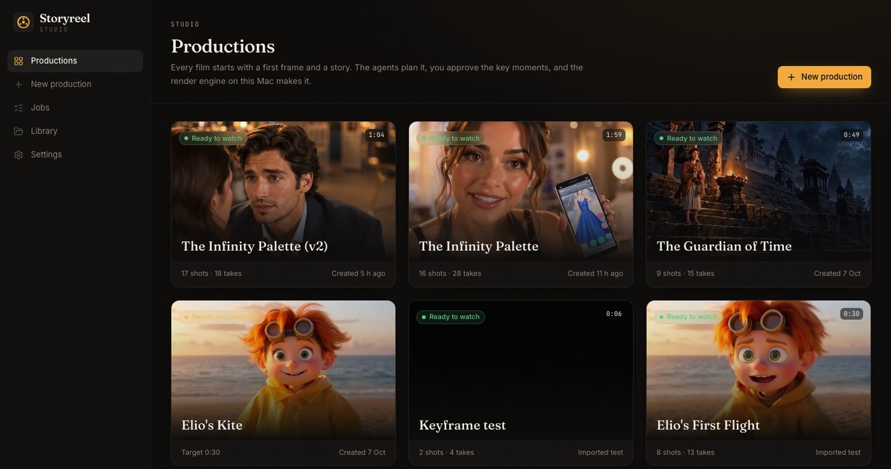
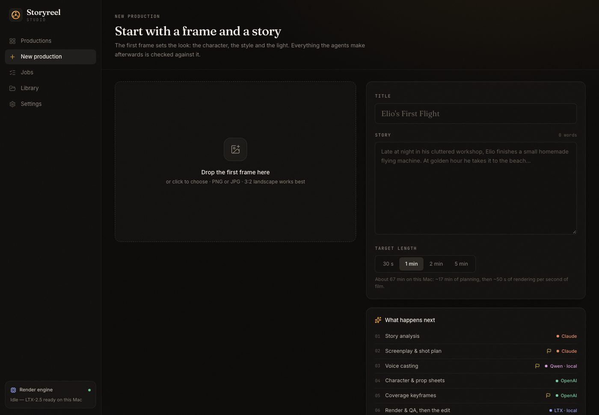
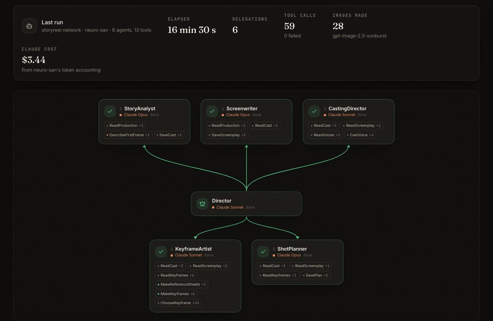
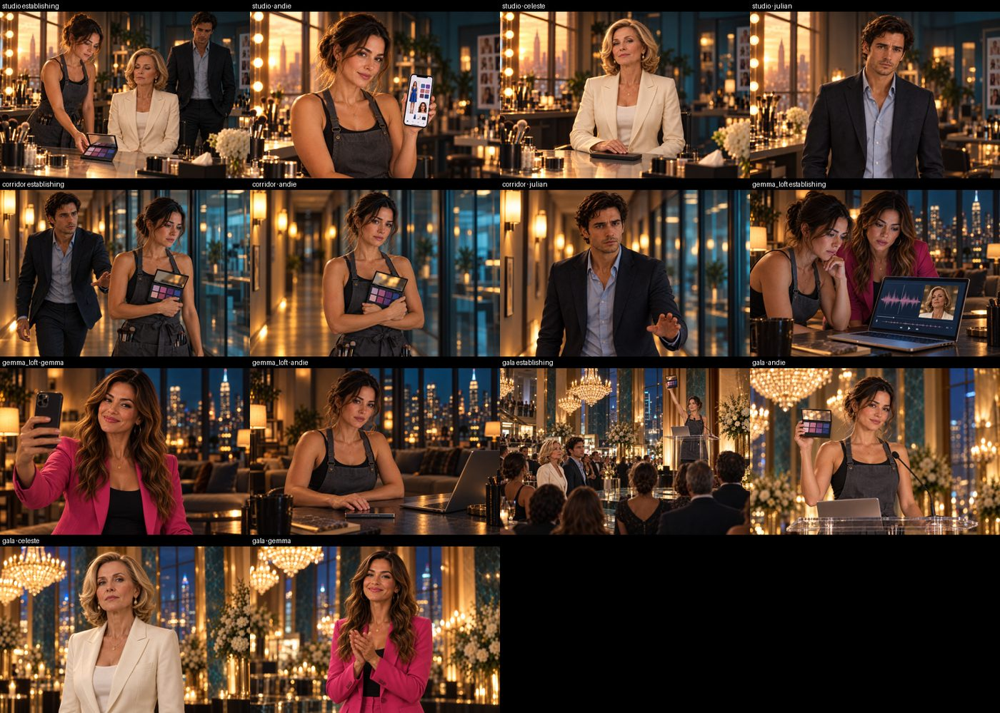
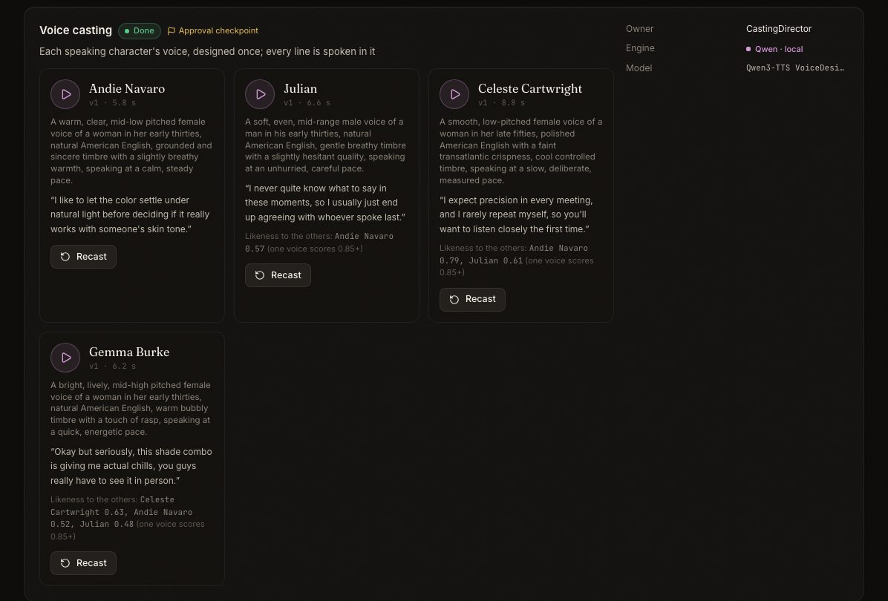
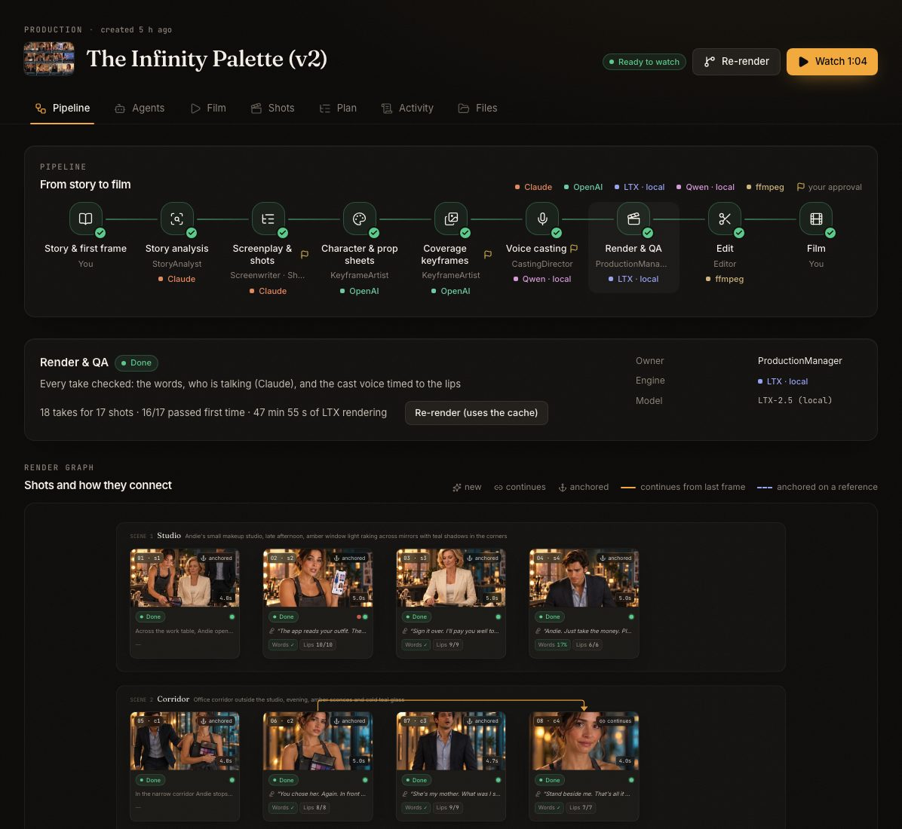
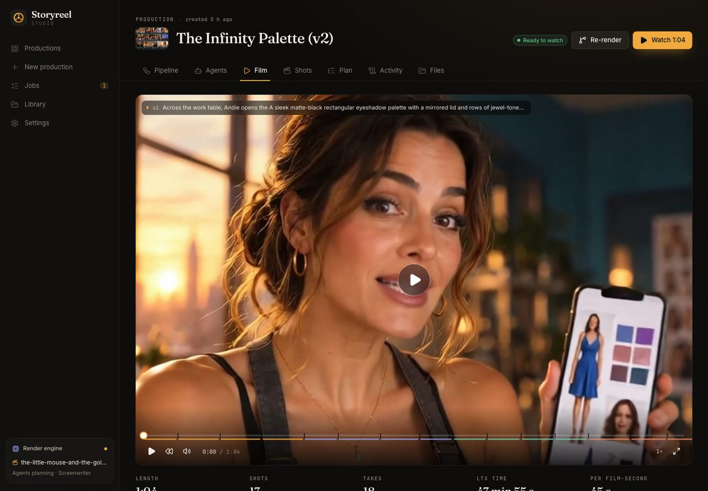
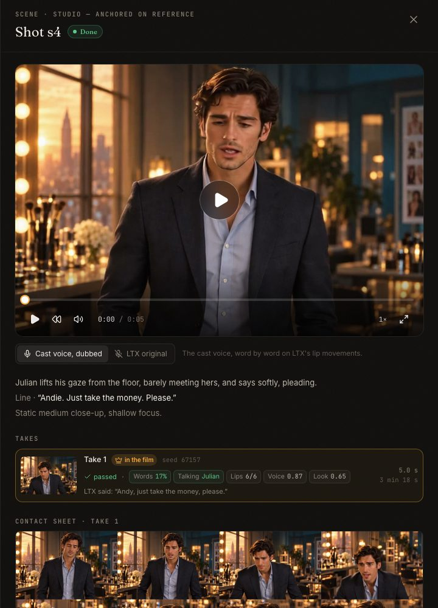

# Storyreel Studio

Make a short film from **a story and your pictures**, on your Mac.



## What it does

1. You give it an **opening frame** and either write a **short story** or ask the AI to invent one. You can also add up to six ordered guide frames and a final frame.
2. AI agents **plan the film**: the characters, the screenplay, a voice for every character, a picture for every shot, and the shot list.
3. You **check and approve** the plan, the pictures and the voices.
4. Your Mac **makes the video** with LTX-2.5, checks every shot, redoes the bad ones, and edits the film.

The studio checks every shot: each character keeps the same voice everywhere, and the person on screen is the one speaking.

## What you need

- A Mac with Apple Silicon (M1 or newer). **64 GB of memory** is best.
- About **100 GB of free disk space**.
- For the default full mode: an **Anthropic API key** (Claude) and an **OpenAI API key**.
- For reduced-capability local mode: [Ollama](https://ollama.com) and a tool-capable local language model.
- A free **Hugging Face** account.

## Setup (one time)

### Step 1. Install the tools

If you don't have [Homebrew](https://brew.sh) yet, install it first. Then:

```bash
brew install uv node ffmpeg git
```

### Step 2. Get the code

```bash
git clone https://github.com/souravJBcognizant/storyreel-studio.git
cd storyreel-studio
```

### Step 3. Install the app

```bash
uv sync
cd web && npm install && cd ..
```

### Step 4. Install the video engine (LTX)

```bash
git clone https://github.com/dgrauet/ltx-2-mlx.git ltx-2-mlx
cd ltx-2-mlx && git checkout bfa5755 && uv sync --all-extras && cd ..
```

### Step 5. Download the video model (about 70 GB)

1. Open [huggingface.co/dgrauet/ltx-2.5-mlx-q8](https://huggingface.co/dgrauet/ltx-2.5-mlx-q8) and accept the license.
2. Make a token at [huggingface.co/settings/tokens](https://huggingface.co/settings/tokens), then log in:
   ```bash
   uv run hf auth login
   ```
3. Download the model. This takes 30 to 60 minutes:
   ```bash
   scripts/fetch_ltx.sh
   ```
   You can follow the progress in `models/download-ltx.log`.

### Step 6. Choose full mode or local mode

#### Full mode (default)

```bash
cp .env.example .env
open -e .env
```

Paste your keys after `ANTHROPIC_API_KEY=` and `OPENAI_API_KEY=`, then save the file.
The `.env` file stays on your Mac. It is never uploaded to GitHub.

Full mode uses the existing Claude and OpenAI defaults and includes first-frame inspection, reference
sheets, generated coverage keyframes and visual speaker checks.

#### Local mode (no model API keys)

Local mode keeps project creation, story planning, screenplay and shot-plan generation, local voice
casting, rendering and editing on the laptop. It deliberately skips features the installed text-only
LLM cannot perform: first-frame inspection, reference-sheet and keyframe generation, and visual QA.
Shots start from written character descriptions instead of generated keyframes, so visual continuity
will usually be weaker than in full mode.

Install and start Ollama, make sure your model appears in `ollama list`, then put this in `.env`:

```dotenv
LOCAL_MODE=true
LLM_PROVIDER=ollama
OLLAMA_BASE_URL=http://127.0.0.1:11434
OLLAMA_MODEL=hf.co/unsloth/Qwen3-4B-Instruct-2507-GGUF:UD-Q4_K_XL
OLLAMA_TIMEOUT_SECONDS=600

# Keep cloud credentials commented in local mode.
# ANTHROPIC_API_KEY=your-existing-key
# OPENAI_API_KEY=your-existing-key

# This Qwen model is text-only; local mode marks these features unavailable.
VISION_PROVIDER=ollama
OLLAMA_VISION_MODEL=
IMAGE_PROVIDER=local
LOCAL_IMAGE_BASE_URL=
LOCAL_IMAGE_MODEL=
```

The model name must exactly match `ollama list`. The example above is the Qwen model used by the
original developer machine; use your own installed tag on another laptop.

To return to the existing full workflow, set `LOCAL_MODE=false` (or remove it), remove the local
provider overrides, and uncomment the two API keys. Cloud mode remains the code default.

### Step 7. Start the studio

```bash
scripts/dev.sh
```

Open **http://localhost:5288** in your browser. Press `Ctrl+C` in the terminal to stop it.

The first film downloads a few smaller models by itself (speech and voice, about 10 GB).

## Make your first film

**1. Start a new production.** Choose **Start from scratch** to add an opening picture and pick a length,
or **Start from an existing production** to make an independent copy of its story, references, plan, voices,
takes and finished film. Copies can be edited or deleted without affecting the original, but duplicate the
media on disk. When starting from scratch, optionally add guide pictures in
story order and a final picture. Then choose either **I’ll write it** to provide the title and story yourself,
or **Invent from images** and leave a simple direction such as “Generate an interesting story.” In that mode,
the AI chooses the title, characters, plot and ending, using the pictures as chronological anchors when a
vision-capable model is configured. The renderer distributes the guides across the shot timeline and pins the
final picture to the end of the last shot.

In local mode, a multimodal model set in `OLLAMA_VISION_MODEL` can invent the story from the actual image
contents. With a text-only model such as the 4B Qwen setup, the studio says that it cannot inspect the pictures,
invents the story from the direction alone, and still applies every uploaded picture directly to the timeline.



**2. Click "Plan with agents".** This takes about 15 minutes in full mode and can take longer with a
small local model. Open the **Agents** tab to watch them work.



**3. Check the pictures.** Every scene gets one wide picture, plus a close-up of each person who speaks in it.



**4. Listen to the voices.** Press play on each card. If a voice doesn't fit, click **Recast** and describe the voice you want. When you are happy, approve the plan, the pictures and the voices.



**5. Click "Render film".** Your Mac needs about 50 seconds for each second of film, so a 1-minute film takes about an hour. You can close the page; the render keeps going and keeps the Mac awake.



**6. Watch your film** in the **Film** tab.



Click any shot to see its takes and the checks it passed. You can switch between overlay audio and original audio.

To use a clip's original sound in the exported film, open the shot and set **Audio in exported film** to
**Original audio** instead of **Overlay audio**. Choices are saved per shot. In the **Film** tab, click **Rebuild film**, then
**Export MP4** when it finishes. The export is one complete, shareable MP4 containing the full picture
and soundtrack. Rebuilding reuses the video takes and updates older audio overlays.
The overlay follows the original recording's speech starts, pauses, and word timing, using continuous
time stretching within each phrase to keep speech smooth. When a period, ellipsis, question mark,
exclamation point, or semicolon coincides with a real pause in the original performance, the studio
generates the phrases on either side separately so each can be aligned to that pause. This improves
sync without regenerating the video. Exact lip sync still depends on the original performance and
timing recognition; choose original audio when the two deliveries differ too much to align naturally.

To revise one shot, click its card in **Shots and how they connect** (or open it from the Film or Shots tab),
then use **Reference images** above the edit prompts to add, replace or remove
the clip's start and end frames. These changes affect the next generated take while existing takes remain
available. If a clip has no uploaded start reference, it automatically starts from the final frame of the
preceding clip (except the first clip, which has no predecessor). Buttons below the references can also copy
the previous clip's last frame or the next clip's first frame into those slots. Use **Re-render shot** for a
new variation with the same direction, or describe a change under **Generate a new clip**. The studio renders new takes for that
shot, selects the best result through the same checks, and rebuilds the MP4 without rendering the other
shots again. For a speaking shot, **Regenerate overlay audio** accepts a delivery
direction such as “quieter and more hesitant.” The scripted words stay fixed; the new delivery is
aligned to the timing of the original performance before the film is rebuilt.



### Change the timeline

Open the **Plan** tab to build or revise the timeline after the first plan has been created:

- Click **Add scene** to start a blank scene, duplicate one from the current production, or import one
  from another production. An imported scene copies its reference images, required character and voice
  assets, and—when selected—finished takes. It remains usable if the source production is deleted.
- Use the controls in a scene header to edit its setting and sound, move it earlier or later, duplicate it,
  or delete it.
- Click **Add shot to scene**, or the plus beside an existing shot to insert immediately after it. A shot's
  action, camera, length, character, line, speaker, and on/off-camera delivery can all be edited in place.
- Click anywhere else on a shot to open its reference images, takes, audio options, and re-render controls.
  Shots can also be reordered within their scene or removed from the timeline.

Timeline changes keep existing render files in the cache and repair continuation links where necessary.
After deleting or reordering shots, open **Film** and click **Rebuild film**. This quickly assembles a new MP4
from the remaining chosen takes; it does not generate those videos again, and deleted shots are left out.

A newly inserted shot without its own start frame continues from the final frame of the shot immediately
before it. New shots—and existing shots whose action, timing, camera or references you changed—need video
generation: click **Re-render**. The cache reuses every unchanged shot, so only the missing or changed clips
are generated before the film is assembled again.

To remove an entire production, return to **Productions**, hover over its card, click the trash icon and
confirm. This permanently deletes that production's local inputs, plans, takes and finished film. Imported
test productions and productions with a running job cannot be deleted.

## How it works

| Step | Done by | Runs on |
|---|---|---|
| Story, screenplay, shot list | Claude agents (neuro-san) | Claude API |
| A voice for every character | Qwen3-TTS | your Mac |
| Character sheets and keyframes | OpenAI images, checked by Claude | OpenAI API |
| Video | LTX-2.5 | your Mac |
| Checks: the words, who is talking | Whisper and Claude | your Mac and Claude API |
| Edit and sound | ffmpeg | your Mac |

In local mode, Ollama/Qwen replaces Claude for the text-agent rows. Qwen3-TTS, LTX and ffmpeg are
already local. The image and visual-inspection rows are marked **skipped**, not silently approximated;
the renderer makes text-driven shots without generated keyframes. Images you upload are still used
directly as opening, guide and final-frame constraints, even though the text-only model cannot inspect them.
This is a genuinely laptop-only mode,
but it is not feature-equivalent to the default full mode.

## If something goes wrong

- **The model download says 403:** you have not accepted the license yet (Step 5.1).
- **The Settings page says a key is missing:** check `.env`, then stop and start the studio again.
- **Ollama local mode cannot connect:** run `ollama serve`, verify the exact tag with `ollama list`, then restart the studio.
- **The local agent misses a step or emits a malformed tool call:** a 4B model is much less reliable than the default cloud models. Re-run planning, shorten the story, or switch back to full mode.
- **A shot says "needs review":** the best take is still used in the film. Open the shot to see which check it failed and why.
- **A render stopped half way:** click **Render film** (or **Re-render**) again. Shots that are already made are reused, so it carries on where it stopped.

## Folders

| Folder | What is inside |
|---|---|
| `storyvid/` | The engine: render, checks, voices, edit, and the web API |
| `agents/` | The agent network (neuro-san) and its tools |
| `web/` | The studio app (React) |
| `productions/` | Your films. Made by the app, never uploaded |
| `stage0/` to `stage3/` | The tests that shaped the design |

## License note

The LTX-2.x model has its own license. Companies with $10M or more in yearly revenue may use it for free **only for non-commercial testing**. Using it in a product needs a paid license from Lightricks. Videos you share must say they were made by AI; every film from this studio has that note in its file.
